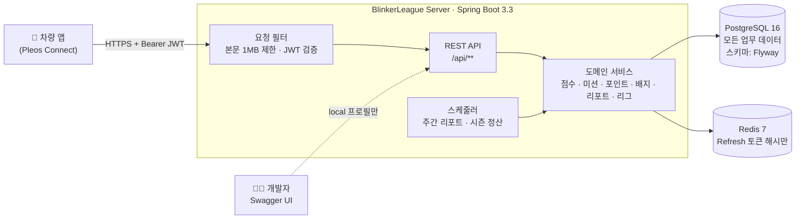
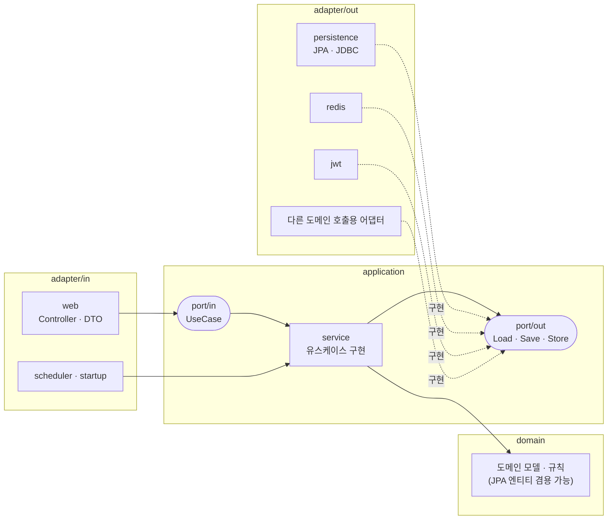
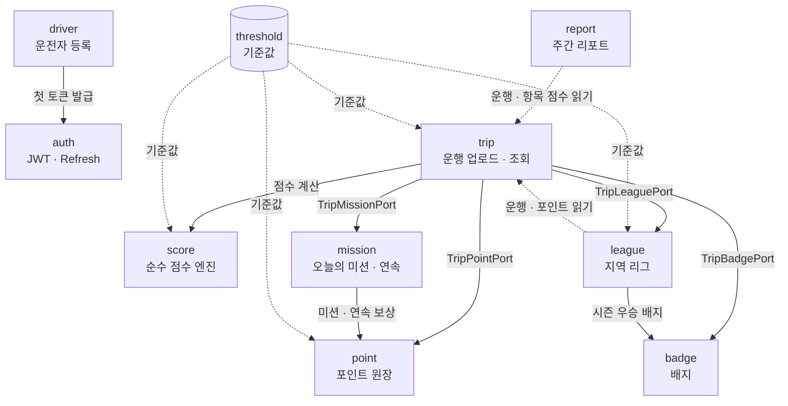
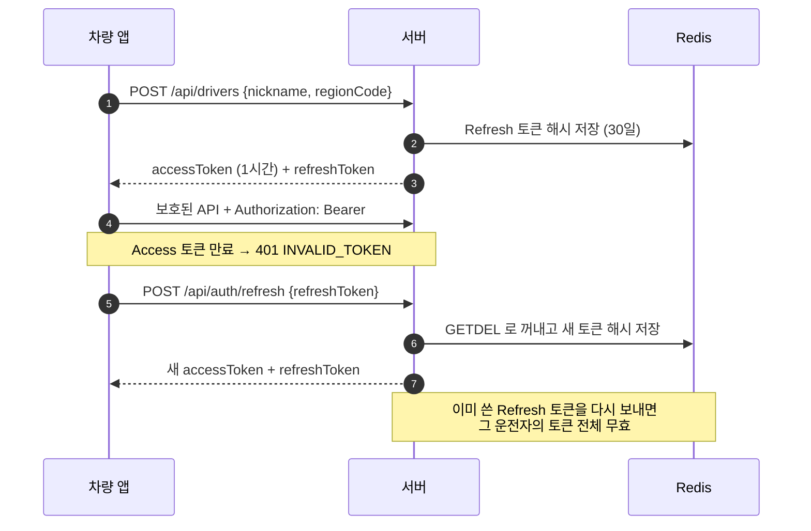
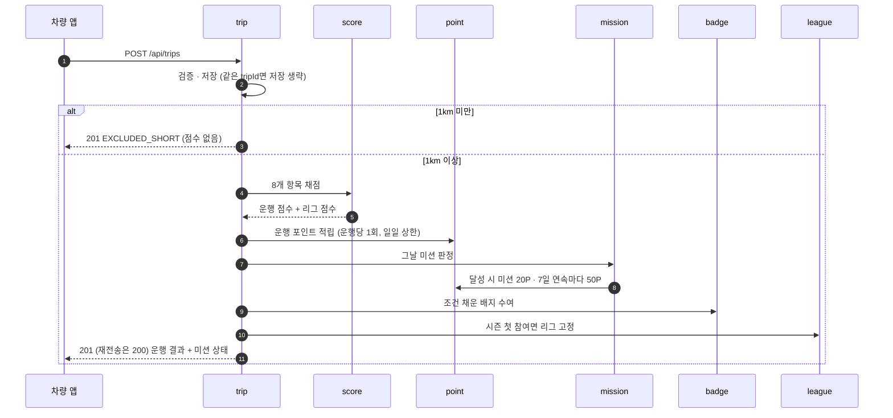
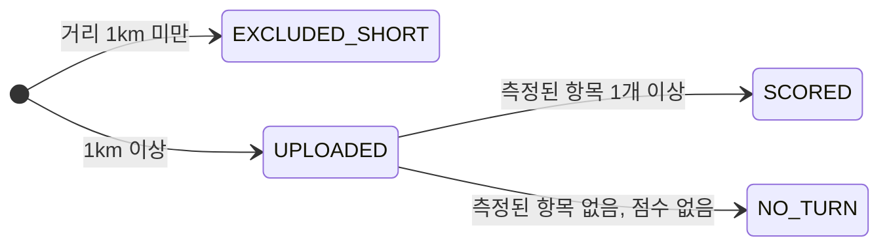
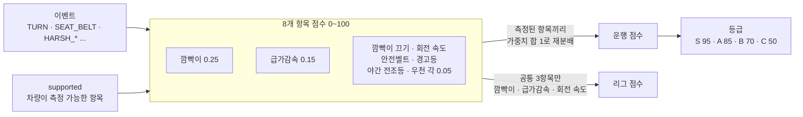
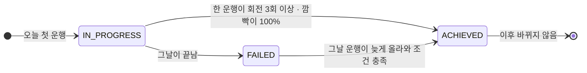
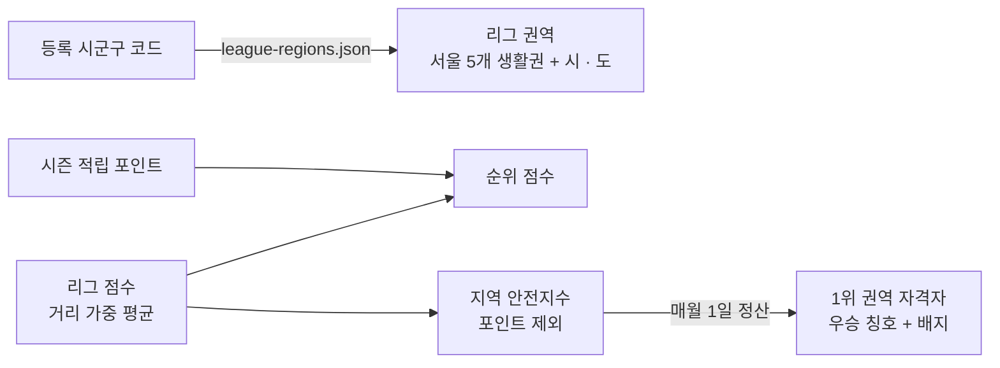

# BlinkerLeague Server

깜빡이리그(BlinkerLeague) 백엔드 서버입니다. 차량 앱이 올린 운행 기록으로 깜빡이 사용과 안전 운전 습관에 점수를 매기고, 미션 · 포인트 · 배지 · 주간 리포트 · 지역 리그로 이어 줍니다.

> 이 문서는 2026-11-14 `develop` 기준입니다(P0 기능 전부 반영). API 명세는 [`docs/api/openapi.json`](docs/api/openapi.json)과 같은 내용이며, 둘이 다르면 Swagger(코드)가 기준입니다.

| 문서 | 내용 |
| --- | --- |
| 이 README | 아키텍처 · 기능 그림, API 명세 요약, 실행 방법, 협업 규칙 |
| [`docs/api/openapi.json`](docs/api/openapi.json) · Swagger UI | 요청 · 응답 필드 전체 명세(원본은 컨트롤러 어노테이션) |
| [`docs/server-run-guide.md`](docs/server-run-guide.md) | 설치부터 등록 → 운행 업로드 → 점수 확인까지의 실행 가이드 |
| [`docs/policies.md`](docs/policies.md) | 결정된 정책(D번호) 요약 |
| [`plan.md`](plan.md) | 기능별 설계와 결정 기록 |
| [`docs/deployment.md`](docs/deployment.md) | 배포 · 운영 DB 설계(배포는 보류 중, D36) |
| `http/*.http` | 로컬 수동 테스트용 요청 모음 |

## 아키텍처

### 시스템 구성



- 서버는 데이터만 돌려주고, 차량을 제어하는 명령은 보내지 않습니다.
- 순위 · 리포트는 저장된 운행에서 그때그때 계산합니다(Redis 캐시 없음).

### 코드 구조: 헥사고날(포트와 어댑터)

모든 도메인은 같은 모양입니다. 의존은 항상 안쪽(`adapter → application → domain`)으로만 향하고, `HexagonalArchitectureTest`(ArchUnit)가 빌드에서 검사합니다.



```
com.blinkerleague.server
├── auth · driver · threshold · trip · score · mission · point · badge · report · league   ← 도메인
│   └── domain / application(port/in, port/out, service) / adapter(in/web, out/<기술>)
├── common    ← 오류 응답, JPA 공통, 시간(Asia/Seoul Clock), 요청 크기 제한, OpenAPI
└── security  ← SecurityConfig, JWT 인코더 · 디코더
```

### 도메인 관계

운행 업로드(`trip`)가 중심이고, 다른 도메인은 `trip`의 out-port를 통해 호출됩니다. 숫자는 모두 `threshold`에서 읽습니다.



## 서버가 제공하는 기능

| 기능 | 한 줄 요약 | API |
| --- | --- | --- |
| 🔑 등록 · 인증 | 닉네임 + 시군구 코드로 등록 → 토큰 발급(로그인 없음) | `POST /api/drivers`, `POST /api/auth/refresh` |
| ⚙️ 기준값 | 판정 기준 · 가중치 · 포인트 규칙 · 등급 · 팁을 `version`과 함께 배포 | `GET /api/config/thresholds` |
| 🚗 운행 업로드 | 운행 1건 + 이벤트 저장, 재전송 안전, 업로드하면서 바로 채점 | `POST /api/trips` |
| 📊 운행 점수 | 8개 항목 → 0~100점 · 등급, 골 · 실점 · 플레이 목록 | `GET /api/trips/{tripId}/score`, `GET /api/trips` |
| 🎯 오늘의 미션 | 하루 중 한 운행이 "회전 3회 이상 · 깜빡이 100%"면 달성 | `GET /api/missions/today` |
| 💰 포인트 | 운행 · 미션 · 연속 달성 보상, 하루 150P 상한 | `GET /api/points` |
| 🏅 연속 · 배지 | 연속 달성 일수, 배지 4종 자동 수여 | `GET /api/streak`, `GET /api/badges` |
| 📈 주간 리포트 | 지난주 대비 항목 점수, 약점으로 다음 주 맞춤 미션 자동 등록 | `GET /api/reports/weekly` |
| 🏆 지역 리그 | 월 시즌, 권역별 순위 · 지역 안전지수, 시즌 우승 칭호 | `GET /api/leagues/current`, `PUT /api/drivers/me/league-visibility` |

### 🔑 토큰 흐름



### 🚗 운행 한 건을 올리면 일어나는 일



같은 `tripId`를 다시 보내면 저장 · 채점은 건너뛰고 처음 결과를 200으로 돌려주되, 포인트 · 미션 · 배지 · 리그 단계는 다시 시도합니다. 각 단계는 한 번만 반영되므로 재전송이 곧 복구 경로입니다.

### 📊 운행 상태와 점수 계산





측정하지 못한 항목은 `UNSUPPORTED`(차량 미지원) 또는 `NOT_APPLICABLE`(회전 없음 · 야간 아님 등)로 표시되고 점수에서 빠집니다.

### 🎯 오늘의 미션



### 💰 포인트

| 적립 사유 | 금액 | 언제 |
| --- | --- | --- |
| `TRIP` | `floor(min(거리, 50km) × 점수 ÷ 100)` | 점수가 난 운행마다 한 번 |
| `DAILY_MISSION` | 20P | 오늘의 미션 달성 |
| `STREAK_7` | 50P | 연속 달성이 7일의 배수가 된 날 |

모두 하루 150P 상한 안에서만 적립되고, 잔액은 원장의 합계입니다. 교환처는 없고(D33) 리그 순위 점수에 더해집니다(D34).

### 🏆 지역 리그



| 조건 | 기본값 |
| --- | --- |
| 시즌 | 달력 월(Asia/Seoul), 리그는 시즌 첫 참여 때 고정 |
| 순위 자격 | 시즌 50km 또는 10회 이상 |
| 순위 공개 | 리그 점수가 있는 참여자 10명 이상인 권역만 |
| 표시 | 상위 10명, 순위 비공개로 설정한 운전자는 목록 · 안전지수 · 우승에서 제외 |

### ⏰ 정기 작업

| 시각(Asia/Seoul) | 작업 |
| --- | --- |
| 매주 월요일 04:00 | 지난주 주간 리포트 미리 생성(실패하면 조회할 때 생성) |
| 매월 1일 00:10 | 지난 시즌 정산: 안전지수 1위 권역의 순위 자격자에게 우승 칭호와 `SEASON_CHAMPION` 배지 |

### ⚙️ 기준값과 데이터 파일

숫자는 코드에 없고 기준값에서 읽습니다. 처음 시작할 때 아래 파일을 DB에 넣습니다(`src/main/resources/`).

| 파일 | 내용 |
| --- | --- |
| `thresholds/default-thresholds.json` | 판정 기준 · 가중치 · 등급 · 포인트 · 리그 숫자 (`GET /api/config/thresholds`) |
| `missions/default-missions.json` | 오늘의 미션 |
| `badges/default-badges.json` | 배지 카탈로그 |
| `reports/weekly-missions.json` | 주간 맞춤 미션 템플릿(항목마다 1개) |
| `leagues/league-regions.json` | 시군구 → 리그 권역 매핑 |

## API 명세

### 공통 규칙

- **인증**: `POST /api/drivers`, `POST /api/auth/refresh`, `GET /api/config/thresholds`를 뺀 모든 API는 `Authorization: Bearer <accessToken>` 헤더가 필요합니다. 토큰은 헤더(재발급만 JSON 본문)로만 받고 URL에는 넣지 않습니다.
- **오류 응답**: 모두 `{ "code", "message" }` 형식입니다. 앱은 `code`로 분기하고 `message`는 안내용입니다.
- **시각**: ISO-8601(오프셋 포함, 예: `2026-11-03T08:00:00+09:00`). 일 · 주 · 월 집계는 Asia/Seoul 기준입니다.
- **ID**: `tripId` · `eventId`는 앱이 만든 UUID(최대 36자)입니다.

| 오류 코드 | HTTP | 언제 |
| --- | --- | --- |
| `INVALID_INPUT` | 400 | 필수 값 누락, 형식 · 범위 위반, 알 수 없는 enum 값 |
| `UNAUTHORIZED` | 401 | 보호된 API에 토큰이 없음 |
| `INVALID_TOKEN` | 401 | 위조 · 만료된 Access 토큰, 없거나 이미 쓴 Refresh 토큰 |
| `NOT_FOUND` | 404 | 없는 대상(남의 운행 포함), 운영 중인 미션 없음 |
| `METHOD_NOT_ALLOWED` | 405 | 지원하지 않는 HTTP 메서드 |
| `CONFLICT` | 409 | 이미 쓰는 닉네임, 다른 운전자가 쓴 `tripId` |
| `PAYLOAD_TOO_LARGE` | 413 | 요청 본문 1MB 초과 |
| `INTERNAL_ERROR` | 500 | 서버 오류(예: Redis가 꺼진 상태의 등록 · 재발급) |

### 엔드포인트 목록

| 분류 | 메서드 | 경로 | 인증 | 성공 | 오류 |
| --- | --- | --- | --- | --- | --- |
| 운전자 | `POST` | `/api/drivers` | 없음 | 201 | 400, 409 |
| 운전자 | `PUT` | `/api/drivers/me/league-visibility` | Bearer | 200 | 400, 401, 404 |
| 인증 | `POST` | `/api/auth/refresh` | 없음 | 200 | 400, 401 |
| 설정 | `GET` | `/api/config/thresholds` | 없음 | 200 | - |
| 운행 | `POST` | `/api/trips` | Bearer | 201(새 운행), 200(재전송) | 400, 401, 409, 413 |
| 운행 | `GET` | `/api/trips?limit=10` | Bearer | 200 | 400, 401 |
| 운행 | `GET` | `/api/trips/{tripId}/score` | Bearer | 200 | 401, 404 |
| 미션 | `GET` | `/api/missions/today` | Bearer | 200 | 401, 404 |
| 미션 | `GET` | `/api/streak` | Bearer | 200 | 401 |
| 포인트 | `GET` | `/api/points` | Bearer | 200 | 401 |
| 배지 | `GET` | `/api/badges` | Bearer | 200 | 401 |
| 리포트 | `GET` | `/api/reports/weekly?week=2026-W45` | Bearer | 200 | 400, 401 |
| 지역 리그 | `GET` | `/api/leagues/current` | Bearer | 200 | 401 |

### 운전자 · 인증

**`POST /api/drivers`** 운전자 등록

```json
// 요청
{ "nickname": "깜빡왕", "regionCode": "11680" }
// 201 응답
{ "driverId": 1, "nickname": "깜빡왕", "regionCode": "11680", "accessToken": "...", "refreshToken": "..." }
```

- 닉네임 2~12자, 지역 코드는 시군구 5자리 숫자(400 `INVALID_INPUT`). 이미 쓰는 닉네임은 409 `CONFLICT`.
- 로그인 API는 없습니다. 토큰을 잃으면 다시 등록합니다(P0).

**`POST /api/auth/refresh`** 토큰 재발급

- 요청 `{ "refreshToken": "..." }` → 200 `{ "accessToken", "refreshToken" }`.
- 쓴 Refresh 토큰은 무효가 되고, 이미 쓴 토큰을 다시 보내면 401 `INVALID_TOKEN`과 함께 그 운전자의 토큰 전체가 무효가 됩니다. `refreshToken` 누락은 400.

**`PUT /api/drivers/me/league-visibility`** 리그 순위 공개 설정(D8)

- 요청 `{ "visible": false }` → 200 `{ "visible": false }`. 기본은 공개입니다.
- 끄면 순위 목록 · 안전지수 · 시즌 우승에서 빠지고 내 순위도 볼 수 없습니다. 참여자 수에는 남으므로 다른 운전자의 순위 공개에는 영향이 없습니다.
- `visible` 누락은 400, 토큰의 운전자가 없으면 404.

### 설정

**`GET /api/config/thresholds`** 판정 기준값(인증 없음)

- 응답 필드: `version`, `trip`, `turn`, `harsh`, `safetyWarning`, `signalCancel`, `seatBelt`, `rain`, `weights`, `minSamples`, `point`, `league`, `grades`, `tips`. 기본값은 `thresholds/default-thresholds.json`에 있습니다.
- `turn`의 `steeringEnterDeg` · `steeringExitDeg` · `mergeGapSec` · `steeringRightPositive`는 앱의 핸들 각도 회전 감지용이며 서버 점수에는 쓰지 않습니다.
- 앱은 시작할 때 받아 두고 `version`이 바뀐 경우에만 갱신합니다.

### 운행

**`POST /api/trips`** 운행 · 이벤트 업로드(D15)

```json
{
  "tripId": "3f0c7e9a-...",
  "startedAt": "2026-11-13T08:00:00+09:00",
  "endedAt": "2026-11-13T08:30:00+09:00",
  "distanceKm": 12.4,
  "supported": ["TURN_SIGNAL", "SMOOTH_DRIVING", "SEAT_BELT"],
  "events": [
    { "eventId": "a1b2...", "type": "TURN", "occurredAt": "2026-11-13T08:05:00+09:00",
      "payload": { "direction": "LEFT", "signalOn": true, "signalTiming": "ON_TIME" } }
  ]
}
```

- `supported`: 이 차량이 측정할 수 있는 점수 항목. 없는 항목은 `UNSUPPORTED`로 빠집니다.
- 이벤트 `type`과 `payload`(서버는 JSON 그대로 저장하고 점수에 필요한 값만 읽음, 원시 위치 좌표는 받지 않음):

| type | payload |
| --- | --- |
| `TURN` | `direction`(`LEFT`/`RIGHT`), `signalOn`, `signalTiming`(`ON_TIME`/`LATE`/`WRONG_DIRECTION`/`NONE`), `leadDistanceM`, `maxSpeedKmh`. `signalTiming`이 있으면 4단계, 없으면 `signalOn`으로 판정. boolean `signalOn`이 없으면 깜빡이 안 켠 회전(D23) |
| `SIGNAL_LEFT_ON` | `durationSec` |
| `SEAT_BELT` (운행당 1건) | `buckledAtDeparture`, `unbuckledMovingSec` |
| `NIGHT_SEGMENT` | `durationSec`, `headlightOffSec` |
| `RAIN_SEGMENT` | `durationSec`, `headlightOffSec`, `knownLimitSec`, `overRainLimitSec` |
| `HARSH_ACCEL` · `HARSH_BRAKE` · `SAFETY_WARNING` | 없음(횟수만 셈) |
| `LANE_CHANGE` | 없음. 저장만 하고 점수에 쓰지 않음(D14) |

- 응답: 새로 저장하면 201, 같은 운전자의 같은 `tripId` 재전송은 저장 없이 처음 결과를 200으로. 본문은 아래 점수 조회와 같은 운행 결과입니다.
- 400 `INVALID_INPUT`: 필수 값 누락, 음수 거리, ID 36자 초과, 알 수 없는 `type`, `endedAt` ≤ `startedAt`, 운행 구간 밖 이벤트, 중복 `eventId`, `supported` 안의 `null`, 이벤트 2,000개 초과(D16), `endedAt`이 지금 + 5분보다 뒤이거나 `startedAt`이 지금 − 7일보다 앞(D17). 개수 · 시각 제한은 새 운행에만 적용합니다.
- 409 `CONFLICT`: 다른 운전자가 쓴 `tripId`. 413 `PAYLOAD_TOO_LARGE`: 본문 1MB 초과.

**`GET /api/trips/{tripId}/score`** 운행 결과

```json
{
  "tripId": "3f0c7e9a-...", "status": "SCORED", "score": 87, "grade": "A",
  "metrics": [{ "metric": "TURN_SIGNAL", "status": "SCORED", "reason": null, "value": 1.0, "score": 100, "weight": 0.5, "detail": { } }],
  "turns": { "total": 4, "success": 3 },
  "summary": { "goals": 3, "conceded": 1, "fouls": 0 },
  "plays": [{ "occurredAt": "...", "type": "TURN", "direction": "LEFT", "result": "GOAL" }],
  "mission": { "missionId": 1, "status": "ACHIEVED" }
}
```

- `status`: `SCORED`, `NO_TURN`(측정할 수 있는 항목이 없어 `score` = `null`), `EXCLUDED_SHORT`(1km 미만, 점수 없음).
- `metrics`: 8개 항목(`TURN_SIGNAL`, `SIGNAL_CANCEL`, `TURN_SPEED`, `SMOOTH_DRIVING`, `SEAT_BELT`, `SAFETY_WARNING`, `NIGHT_HEADLIGHT`, `RAIN_DRIVING`)을 모두 담습니다. 측정하지 못한 항목은 `status`가 `UNSUPPORTED`(`SIGNAL_NOT_SUPPORTED`) 또는 `NOT_APPLICABLE`(`NO_TURN` · `TOO_FEW_SAMPLES` · `NO_SPEED` · `NO_NIGHT` · `NO_RAIN` · `NO_DATA`)이고 `value` · `score` · `weight`가 `null`입니다. `weight`는 재분배한 값, `detail`은 화면용 근거 수치입니다.
- `summary` · `plays`(D22): 골 = 깜빡이 켠 회전, 실점 = 안 켠 회전, 파울은 P0에서 항상 0. `plays`는 모든 이벤트를 시각순으로 담고 `TURN`만 `result`(`GOAL`/`CONCEDED`)와 `direction`이 있습니다.
- `mission`: 이 운행이 끝난 날의 미션 판정(`IN_PROGRESS` · `ACHIEVED` · `FAILED`). 그날 운영 중인 미션이 없으면 `null`.
- 없는 운행 · 남의 운행은 404 `NOT_FOUND`.

**`GET /api/trips?limit=10`** 최근 경기 목록(D24)

- 내 운행을 종료 시각 최신순으로 `[{ "tripId", "endedAt", "distanceKm", "status", "score", "grade" }]`.
- `limit` 기본 10, 50보다 크면 50, 1 미만이거나 숫자가 아니면 400.

### 미션 · 포인트 · 배지

**`GET /api/missions/today`** 오늘의 미션(D25)

```json
{ "missionId": 1, "title": "회전 깜빡이 완벽", "periodKey": "2026-11-14", "status": "IN_PROGRESS", "rewardPoint": 20,
  "progress": { "turns": 2, "successTurns": 2, "requiredTurns": 3 },
  "conditions": [{ "type": "TURN_COUNT", "current": 2, "target": 3 }, { "type": "SIGNAL_RATE", "current": 100, "target": 100 }] }
```

- 운행 1건 = 1라운드. 그날 한 라운드라도 조건을 채우면 `ACHIEVED`(이후 바뀌지 않음), 날이 끝날 때까지 못 채우면 `FAILED`.
- 오늘 첫 운행 전에는 마지막 미션 날의 최종 상태를 그날의 `periodKey`로 보여 줍니다. 운영 중인 미션이 없으면 404.

**`GET /api/streak`** 연속 달성

- `{ "streakDays", "todayAchieved" }`. 오늘 달성했으면 오늘부터, 아니면 어제부터 셉니다.

**`GET /api/points`** 내 포인트

```json
{ "balance": 320, "todayEarned": 30, "dailyCap": 150,
  "entries": [{ "amount": 10, "reason": "TRIP", "description": { "distanceKm": 12.4, "score": 87 }, "createdAt": "2026-11-14T08:31:00+09:00" }] }
```

- `reason`: `TRIP`(운행), `DAILY_MISSION`(미션 달성), `STREAK_7`(연속 달성 보상). `description`은 `TRIP`일 때 적립 당시 거리와 점수입니다.
- 잔액은 전체 적립 합계, `todayEarned`는 Asia/Seoul 오늘, `entries`는 최근 20건. 일일 상한을 넘는 몫은 잘립니다. 포인트 교환은 없습니다(D33). 포인트는 리그 순위 점수에 더해집니다(D34).

**`GET /api/badges`** 배지 진열장

- 전체 배지를 진열 순서로 `[{ "code", "name", "condition", "earned", "awardedAt" }]`. 기본 4종: `FIRST_TRIP`(점수가 난 첫 운행), `STREAK_7`(최장 연속 7일), `SIGNAL_100`(깜빡이 켠 회전 누적 100회), `SEASON_CHAMPION`(시즌 우승).

### 리포트

**`GET /api/reports/weekly?week=2026-W45`** 주간 리포트(D7 B)

```json
{ "week": "2026-W45", "trips": 6, "distanceKm": 84.2,
  "metrics": [{ "metric": "TURN_SIGNAL", "thisWeek": 82.5, "lastWeek": 75.0, "change": 7.5 }],
  "weakestMetric": "SMOOTH_DRIVING",
  "lastMission": { "week": "2026-W45", "metric": "TURN_SIGNAL", "title": "회전 깜빡이 주간 90점", "target": 90, "minDistanceKm": 30, "status": "ACHIEVED" },
  "nextMission": { "week": "2026-W46", "metric": "SMOOTH_DRIVING", "title": "부드러운 운전 주간 90점", "target": 90, "minDistanceKm": 30, "status": "ASSIGNED" } }
```

- 주는 ISO 주(월요일 시작, Asia/Seoul). `week`를 빼면 지난주입니다. 형식이 틀리거나 아직 끝나지 않은 주는 400.
- 항목 값은 거리 가중 평균 점수(0~100). 가장 약한 항목으로 다음 주 맞춤 미션을 자동 등록하고(수락 단계 없음, 포인트 없음), 그 주의 평균이 `target` 이상이고 거리가 `minDistanceKm` 이상이면 `ACHIEVED`, 아니면 `FAILED`로 다음 리포트에서 판정합니다.

### 지역 리그

**`GET /api/leagues/current`** 이번 시즌 내 리그

```json
{
  "season": { "seasonId": "2026-11", "startsAt": "...", "endsAt": "..." },
  "league": { "leagueCode": "SEOUL_SOUTHEAST", "name": "서울 동남권", "participants": 12, "rankingPublished": true, "safetyIndex": 84.3, "rank": 2,
              "rankings": [{ "rank": 1, "nickname": "깜빡왕", "averageScore": 91.2, "points": 340, "score": 431.2 }] },
  "me": { "visible": true, "eligible": true, "averageScore": 88.0, "points": 210, "score": 298.0, "rank": 3, "trips": 11, "distanceKm": 72.5,
          "championships": [{ "seasonId": "2026-10", "leagueCode": "SEOUL_SOUTHEAST", "name": "서울 동남권" }] },
  "regions": [{ "leagueCode": "SEOUL_SOUTHEAST", "name": "서울 동남권", "safetyIndex": 84.3, "rank": 1 }]
}
```

- 시즌은 달력 월(D29). 리그는 등록 지역으로 시즌 첫 참여 때 정해집니다(D12). 등록 지역이 매핑표에 없으면 `league`는 `null`.
- 순위 점수 `score` = `averageScore`(공통 항목 리그 점수의 거리 가중 평균, D19) + `points`(시즌 안에 적립한 포인트, D34). 순위는 동점 공동 순위(1, 2, 2, 4).
- 순위 자격은 시즌 50km 또는 10회 이상(D13). 리그 점수가 있는 참여자가 10명 미만인 권역은 순위를 공개하지 않습니다(D11). `rankings`는 상위 10명.
- `league.safetyIndex`와 `regions`는 지역 안전지수(리그 점수의 거리 가중 평균, 포인트 제외, D5)와 그 순위입니다. `championships`는 내 시즌 우승 칭호(D30)입니다.

### Swagger · OpenAPI 명세 보기

요청 · 응답 필드, 상태 코드, 오류 코드 전체는 OpenAPI 명세에 있습니다. 컨트롤러에서 자동으로 만들어집니다(springdoc-openapi).

- **Swagger UI**: `local` 프로필로 서버를 띄운 뒤 <http://localhost:8080/swagger-ui.html>. 오른쪽 위 `Authorize`에 Access 토큰을 넣으면 보호된 API도 바로 호출할 수 있습니다.
- **명세 JSON**: <http://localhost:8080/v3/api-docs>
- **전달용 파일**: [`docs/api/openapi.json`](docs/api/openapi.json). 서버 없이 [Swagger Editor](https://editor.swagger.io/), Postman, IntelliJ에서 열 수 있습니다.
- 배포 환경에서는 노출하지 않습니다(`springdoc.*.enabled`는 기본 `false`, `local` 프로필에서만 `true`).

### Swagger 접속 방법

Swagger는 내 PC에서 띄운 서버(`local` 프로필)에서만 열립니다. 공용 주소는 없습니다.

**1. 서버 실행 준비** (처음 한 번)

```bash
git clone https://github.com/BlinkerLeague/server.git
cd server
cp .env.example .env
openssl rand -base64 48       # 출력값을 .env의 JWT_SECRET= 뒤에 붙여 넣기
openssl rand -hex 24          # 출력값을 .env의 DB_PASSWORD= 뒤에 붙여 넣기
docker compose up -d          # PostgreSQL + Redis (Docker 엔진이 켜져 있어야 함)
```

- JDK 17이 필요합니다.
- Docker 설치는 아래 "Docker 설정"을 참고하세요.
- PostgreSQL이 꺼져 있으면 서버가 뜨지 않습니다. Redis가 없으면 서버와 Swagger는 뜨지만, 운전자 등록과 토큰 재발급이 실패해서 보호된 API를 호출할 수 없습니다.

**2. 서버 실행**

```bash
./gradlew bootRun
```

- 로그에 `Started ServerApplication`이 나오면 준비된 것입니다.
- 프로필을 지정하지 않으면 `local`로 실행됩니다.

**3. 브라우저에서 열기**

- Swagger UI: <http://localhost:8080/swagger-ui.html> (`/swagger-ui/index.html`로 이동합니다)
- 명세 JSON: <http://localhost:8080/v3/api-docs>

**4. 토큰 받기**

1. Swagger UI에서 `POST /api/drivers`를 펼칩니다.
2. `Try it out`을 누릅니다.
3. 아래 본문을 넣고 `Execute`를 누릅니다.

   ```json
   { "nickname": "테스트01", "regionCode": "11680" }
   ```

   - 닉네임은 2~12자이고, 이미 있는 닉네임이면 409가 납니다.
   - 지역 코드는 시군구 5자리 숫자입니다.
4. 응답의 `accessToken` 값을 복사합니다.

**5. 인증하기**

1. 오른쪽 위 `Authorize`를 누릅니다.
2. `bearerAuth` 칸에 `accessToken` 값만 붙여 넣습니다. `Bearer `는 붙이지 않습니다.
3. `Authorize` → `Close`를 누릅니다.

이제 자물쇠가 표시된 API(예: `POST /api/trips`)도 `Try it out`으로 호출할 수 있습니다.

**6. 토큰이 만료되면**

- Access 토큰은 1시간짜리입니다. 만료되면 `POST /api/auth/refresh`에 `{ "refreshToken": "..." }`를 보내 새 토큰을 받고, 다시 `Authorize`합니다.
- 로컬 DB(PostgreSQL)는 서버를 재시작해도 남습니다. DB를 초기화했거나 `.env`의 `JWT_SECRET`을 바꿨다면 4번부터 다시 등록하세요.

**문제가 생기면**

| 증상 | 원인 · 해결 |
| --- | --- |
| `/swagger-ui.html`이 401 `UNAUTHORIZED` 또는 404 | Swagger가 없는 코드로 서버가 떠 있습니다. `git pull`로 최신 `develop`을 받고 서버를 **완전히 재시작**하세요(IntelliJ devtools 자동 재시작으로는 새 라이브러리가 반영되지 않음). `local`이 아닌 프로필로 띄워도 꺼져 있습니다. |
| 서버가 시작되지 않고 `DB_PASSWORD` 오류 또는 `Connection refused` | `.env`에 `DB_PASSWORD`가 없거나 PostgreSQL이 꺼져 있습니다. `.env`를 채우고 `docker compose up -d` 후 다시 실행하세요. |
| 서버가 시작되지 않고 `JWT_SECRET` 오류 | `.env`가 없거나 `JWT_SECRET`이 비었거나 32바이트보다 짧습니다. 1번을 다시 하세요. |
| `Port 8080 was already in use` | 이미 서버가 떠 있습니다. 기존 프로세스를 끄거나 `SERVER_PORT=8081 ./gradlew bootRun`으로 띄우고 주소의 포트를 바꾸세요. |
| 등록 · 토큰 재발급이 500 `INTERNAL_ERROR` | Redis가 꺼져 있습니다. `docker compose up -d` 후 다시 시도하세요. |
| 보호된 API가 401 `UNAUTHORIZED` | `Authorize`를 하지 않았습니다. 5번을 보세요. |
| 보호된 API가 401 `INVALID_TOKEN` | Access 토큰이 만료됐거나(6번), `.env`의 `JWT_SECRET`을 바꾼 뒤 이전 토큰을 쓰고 있습니다(4번부터 다시). |

API를 바꿨으면 `docs/api/openapi.json`을 다시 만들어 함께 커밋합니다. `servers`는 지워 실행 포트가 박히지 않게 하고, `-S`로 키를 정렬해 실행할 때마다 응답 코드 순서가 바뀌어 diff가 생기지 않게 합니다.

```bash
./gradlew bootRun   # 다른 터미널에서
curl -s http://localhost:8080/v3/api-docs | jq -S 'del(.servers)' > docs/api/openapi.json
```

### API 명세 관리 규칙

API 명세는 **Swagger(OpenAPI)로 관리합니다.** 컨트롤러 코드의 어노테이션이 명세의 원본이고, 따로 손으로 쓰는 명세 문서는 두지 않습니다.

- **원본은 코드입니다.** 요청 · 응답 형식, 검증 규칙, 상태 코드, 오류 코드는 컨트롤러와 DTO의 어노테이션(`@Tag`, `@Operation`, `@ApiResponse`, Bean Validation)에 적습니다. 코드와 문서가 어긋나지 않도록 명세를 코드 밖에 따로 두지 않습니다.
- **API를 추가하거나 바꾸는 PR에는 명세도 함께 들어갑니다.**
  - 컨트롤러 어노테이션을 갱신합니다.
  - `ApiDocsTest`에 해당 API의 행을 추가합니다.
  - `docs/api/openapi.json`을 다시 만들어 같은 PR에서 커밋합니다.
- **다른 사람에게는 Swagger로 전달합니다.**
  - 서버를 직접 띄울 수 있는 사람: 저장소를 받아 `local` 프로필로 실행한 뒤 Swagger UI를 엽니다. 실행 순서는 아래 "실행 방법"을 따릅니다.
  - 서버를 띄우기 어려운 사람: `docs/api/openapi.json`을 Swagger Editor나 Postman에서 엽니다.
- **다른 문서의 역할**
  - `plan.md`: 기능 설계와 결정 기록입니다. 명세가 아닙니다.
  - 위 "API 명세" 절: 한눈에 보는 요약입니다.
  - `http/*.http`: 로컬 수동 테스트용입니다.
  - 형식이 서로 다르면 Swagger가 기준입니다.

## 기술 스택

- Java 17
- Spring Boot 3.3.13 (Web, Validation, Data JPA, Data Redis, Security + OAuth2 Resource Server(JWT))
- PostgreSQL 16 (로컬은 Docker, 스키마는 Flyway) · Redis 7 (Refresh 토큰)
- H2 (테스트 전용 인메모리 DB)
- Gradle 7.6.4 (wrapper)
- Lombok
- springdoc-openapi 2.6.0 (Swagger UI, `local` 프로필에서만)
- 테스트: JUnit 5, Testcontainers(PostgreSQL · Redis), ArchUnit(헥사고날 의존 규칙)

> IntelliJ IDEA 2021.3.1의 Gradle 동기화 호환 문제로 Gradle/Boot 버전을 낮춰 두었습니다.
> IDE를 업데이트하기 전에는 버전을 올리지 마세요.

## 실행 방법

> 처음부터 끝까지의 순서(설치, 실행, 등록 → 운행 업로드 → 점수 확인, 문제 해결)는 [`docs/server-run-guide.md`](docs/server-run-guide.md)에 있습니다. 배포 · 운영 DB 설계는 [`docs/deployment.md`](docs/deployment.md)입니다.

JDK 17이 필요합니다. (IntelliJ: Settings → Build Tools → Gradle → Gradle JVM을 17로)

1. 로컬 secret 파일을 만듭니다. `.env`는 git에 올라가지 않습니다.

```bash
cp .env.example .env && chmod 600 .env
openssl rand -base64 48       # 출력값을 .env의 JWT_SECRET= 뒤에 붙여 넣기
openssl rand -hex 24          # 출력값을 .env의 DB_PASSWORD= 뒤에 붙여 넣기
```

2. PostgreSQL과 Redis를 띄우고(아래 Docker 설정) 서버를 실행합니다. **DB가 꺼져 있으면 서버가 시작되지 않습니다.**

```bash
docker compose up -d   # PostgreSQL + Redis
./gradlew bootRun      # 서버 실행 (기본 포트 8080, Flyway가 스키마를 만든다)
./gradlew build        # 빌드 + 테스트 (Testcontainers 테스트가 있어 Docker 엔진이 실행 중이어야 함)
./gradlew test         # 테스트만 실행
```

Windows에서는 `gradlew.bat`을 사용해도 됩니다. `JWT_SECRET`이 없거나 32바이트보다 짧으면, `DB_PASSWORD`가 없으면 서버가 시작되지 않습니다. Gradle 7.6.4는 JDK 17에서 실행해야 합니다(`JAVA_HOME`을 17로, `docs/server-run-guide.md` 8.4).

운영 secret은 저장소에 두지 않고 환경변수(추후 Vault)로 주입합니다.

## Docker 설정 (PostgreSQL · Redis)

로컬 DB는 PostgreSQL 16 컨테이너입니다. 스키마는 서버가 시작할 때 Flyway가 `src/main/resources/db/migration`을 적용해 만들고, 데이터는 볼륨에 남습니다. 접속 정보(`DB_NAME` · `DB_USERNAME` · `DB_PASSWORD`)는 `.env` 하나를 docker compose와 서버가 같이 읽습니다.

Redis는 Refresh 토큰(SHA-256 해시)만 저장합니다. 서버 세션은 쓰지 않습니다(JWT, stateless).
Redis 연결은 처음 쓸 때 맺으므로 Redis 없이도 서버는 뜨지만, 운전자 등록(`POST /api/drivers`)과 토큰 재발급(`POST /api/auth/refresh`)은 실패합니다. 서버 실행 전에 Redis 컨테이너를 먼저 띄웁니다.
설정은 프로젝트 루트의 `docker-compose.yml`에 있습니다.

| 항목 | PostgreSQL | Redis |
| --- | --- | --- |
| 이미지 | `postgres:16-alpine` | `redis:7-alpine` |
| 컨테이너 이름 | `blinkerleague-postgres` | `blinkerleague-redis` |
| 포트 | `127.0.0.1:5432` (내 PC에서만) | `127.0.0.1:6379` (내 PC에서만) |
| 데이터 볼륨 | `postgres-data` | `redis-data` (컨테이너를 지워도 유지) |
| 헬스체크 | `pg_isready` (5초 간격) | `redis-cli ping` (5초 간격) |

서버의 접속 설정은 `application-local.yaml`의 `spring.datasource.*`(`localhost:5432`)와 `application.yaml`의 `spring.data.redis.host/port`(`localhost:6379`)이며 compose 설정과 일치합니다.

### Windows

1. [Docker Desktop for Windows](https://www.docker.com/products/docker-desktop/)를 설치합니다. (WSL 2 백엔드 권장, Windows 10/11 64bit)
2. 설치 후 Docker Desktop을 실행하고 왼쪽 아래 상태가 `Engine running`이 될 때까지 기다립니다.
3. PowerShell 또는 Git Bash에서 프로젝트 루트로 이동해 실행합니다.

```powershell
docker --version              # 설치 확인
docker compose up -d          # PostgreSQL + Redis 시작
docker compose ps             # STATUS가 둘 다 healthy인지 확인
docker exec blinkerleague-redis redis-cli ping   # PONG 이 나오면 정상
.\gradlew.bat bootRun         # 서버 실행
```

주의:

- `docker` 명령이 `daemon is not running` 오류를 내면 Docker Desktop이 아직 실행되지 않은 것입니다.
- 5432 · 6379 포트를 이미 쓰는 프로세스(로컬에 설치한 PostgreSQL · Redis 등)가 있으면 컨테이너가 뜨지 않습니다. `netstat -ano | findstr :5432`로 확인하세요.

### macOS

1. [Docker Desktop for Mac](https://www.docker.com/products/docker-desktop/)(Apple Silicon / Intel 중 맞는 버전)을 설치하거나 Homebrew를 사용합니다.

```bash
brew install --cask docker    # Docker Desktop 설치
```

자세한 macOS 셋팅(Testcontainers 설정, JDK 17)은 [`docs/server-run-guide.md`](docs/server-run-guide.md) 8장에 있습니다. Docker Desktop 대신 화면 없는 colima를 써도 됩니다(둘을 함께 켜지 마세요).

```bash
brew install colima docker docker-compose
colima start
# docker compose 플러그인 경로를 ~/.docker/config.json에 추가
#   "cliPluginsExtraDirs": ["/opt/homebrew/lib/docker/cli-plugins"]
# Testcontainers용: ~/.testcontainers.properties
#   docker.host=unix:///Users/<사용자>/.colima/default/docker.sock
```

2. `Docker` 앱을 한 번 실행해 데몬을 시작합니다. (메뉴바 고래 아이콘이 안정되면 준비 완료)
3. 터미널에서 프로젝트 루트로 이동해 실행합니다.

```bash
docker --version              # 설치 확인
docker compose up -d          # PostgreSQL + Redis 시작
docker compose ps             # STATUS가 둘 다 healthy인지 확인
docker exec blinkerleague-redis redis-cli ping   # PONG 이 나오면 정상
./gradlew bootRun             # 서버 실행
```

주의:

- `postgres:16-alpine` · `redis:7-alpine` 이미지는 Apple Silicon(arm64)과 Intel(amd64)을 모두 지원해 별도 설정이 필요 없습니다.
- 포트 사용 여부는 `lsof -i :5432`, `lsof -i :6379`로 확인합니다. Homebrew로 설치한 PostgreSQL · Redis가 떠 있다면 `brew services stop postgresql@16`, `brew services stop redis`로 먼저 멈추세요.

### 자주 쓰는 명령 (공통)

```bash
docker compose up -d              # 시작 (백그라운드)
docker compose stop               # 중지 (컨테이너 유지)
docker compose down               # 중지 + 컨테이너 삭제 (볼륨 유지)
docker compose down -v            # 컨테이너 + 데이터 볼륨까지 삭제(DB 데이터와 Refresh 토큰 모두)
docker compose logs -f postgres   # 로그 보기(redis도 같음)
docker exec -it blinkerleague-postgres psql -U blinkerleague blinkerleague   # DB 접속
docker exec -it blinkerleague-redis redis-cli   # Redis CLI 접속

# DB만 초기화(Redis 토큰은 유지). 볼륨 이름은 docker volume ls로 확인
docker compose rm -sf postgres && docker volume rm server_postgres-data && docker compose up -d postgres
```

## 브랜치 규칙

| 브랜치 | 용도 | 분기 기준 | 병합 대상 |
| --- | --- | --- | --- |
| `main` | 배포 가능한 안정 버전 | - | - |
| `develop` | 다음 배포를 위한 통합 브랜치 | `main` | `main` |
| `feat/<이름>` | 새 기능 개발 | `develop` | `develop` |
| `fix/<이름>` | 버그 수정 | `develop` | `develop` |
| `refactor/<이름>` | 동작 변경 없는 구조 개선 | `develop` | `develop` |
| `docs/<이름>` | 문서 작성 및 수정 | `develop` | `develop` |
| `hotfix/<이름>` | 배포 중인 버전의 긴급 수정 | `main` | `main`, `develop` |

규칙:

- `main`, `develop`에는 직접 push하지 않고 Pull Request로만 병합합니다.
- 브랜치 이름은 소문자와 하이픈(`-`)을 사용합니다. 예: `feat/match-schedule`, `fix/login-session-expire`
- 한 브랜치에는 하나의 목적만 담습니다.
- 병합이 끝난 브랜치는 삭제합니다.
- 초기 개발 단계에서는 리뷰 승인 없이 PR을 병합할 수 있습니다. (추후 팀 규모가 커지면 리뷰 승인을 필수로 전환)

## 커밋 컨벤션

형식:

```
<type>: <제목>

<본문 (선택)>
```

| type | 설명 | 예시 |
| --- | --- | --- |
| `feat` | 새로운 기능 추가 | `feat: 경기 일정 조회 API 추가` |
| `fix` | 버그 수정 | `fix: 세션 만료 시 로그인 실패 수정` |
| `refactor` | 동작 변경 없는 코드 개선 | `refactor: 팀 서비스 중복 로직 분리` |
| `docs` | 문서 수정 | `docs: README에 브랜치 규칙 추가` |
| `test` | 테스트 추가/수정 | `test: 팀 서비스 단위 테스트 추가` |
| `chore` | 빌드 설정, 의존성 등 기타 작업 | `chore: Gradle 버전 변경` |

규칙:

- 제목은 50자 이내, 마침표 없이 작성합니다.
- 제목은 "무엇을 했는지"가 드러나게 씁니다.
- "왜" 바꿨는지가 필요하면 본문에 적습니다.
- 한 커밋에는 하나의 변경 목적만 담습니다.

## Pull Request 규칙

- 제목은 커밋 컨벤션과 같은 형식을 따릅니다. 예: `feat: 경기 일정 조회 API 추가`
- 변경 내용과 확인 방법(테스트 결과 등)을 본문에 적습니다.
- `./gradlew build`가 통과한 상태에서 올립니다.
- API를 추가하거나 바꿨다면 컨트롤러 어노테이션 · `ApiDocsTest` · `docs/api/openapi.json`을 같은 PR에 포함합니다([API 명세 관리 규칙](#api-명세-관리-규칙)).
